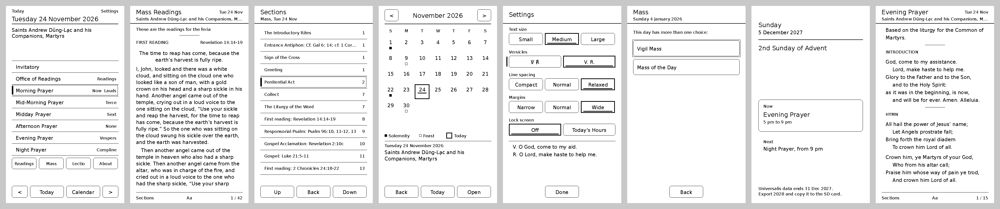

# Divine Office for the Xteink X4 Pro

A Liturgy of the Hours reader for the Xteink X4 Pro (stock XTOS Licorice firmware, as an InkApp).
It shows the day's eight Hours, the Mass readings and texts, Lectio Divina and the notes on the
day, all taken from your own Universalis e-book export.

**Private use only.** Universalis e-books "are for your private use only and must not be given or
distributed to other people". This repository holds the app and the converter only. The e-books
and the data files made from them are kept out by `.gitignore`. Keep the repository private and
never submit the app to the InkApp store.



## What is in it

| path | what it is |
|---|---|
| `app/office/` | the InkApp: `manifest.json`, `index.lua` (the app), `lockscreen.lua` (lock screen), `icon.png` |
| `tools/convert.py` | turns Universalis year EPUBs into the app's data files |
| `tools/xtpack.py` | packs and encrypts the app into an installable `.xtapp` package |
| `tools/emulator/` | scripted runs in the [inkemu](https://pypi.org/project/inkemu/) emulator |
| `docs/` | screenshots |

## Features

- **Today:** date, celebration (with the optional memorial to choose), the eight Hours with the
  current one marked "Now", and buttons for Mass readings, Mass, Lectio Divina and About Today.
  Before 4 am the app still shows the previous day, so Night Prayer stays where you expect it.
- **Reader:** pages turned by tapping, swiping or the side buttons; **Sections** jumps to any part
  (Psalmody, Reading, Gospel, Intercessions); **Aa** cycles the text size.
- **Choices:** days with more than one Mass (Vigil and Mass of the Day, for example) ask which.
- **Reopens where you left off** on the same liturgical day.
- **Calendar:** a month view with solemnities and feasts marked; tap a day to open it.
- **Settings:** text size, ℣ ℟ or V. R., line spacing, margins, lock screen on or off.
- **Lock screen:** today's celebration, the Hour for now and the next one, updated hourly.
- **End-of-data reminder** in December when next year's data is missing.

## Making the data

1. In Universalis (registered copy), export each year as an EPUB e-book for your diocese.
2. Convert (needs Python 3 with `beautifulsoup4` and `lxml`):

   ```
   python3 tools/convert.py uy2026.epub uy2027.epub --out build
   ```

   For 2026 and 2027 this writes about 317 files (40 MB): `cal2026.txt`, `cal2027.txt` and the
   bundles `h…bin` (the Hours), `m…bin` (Mass readings, Lectio Divina, About Today) and `x…bin`
   (Mass texts), each about 120 KB, because the app can only read whole files.
3. Copy everything in `build/` to the SD card folder `XTApps/office/files/` (reader in USB mode).
   The app may store at most 512 files, so keep two years at a time.

Uninstalling the app deletes `XTApps/office/files/`; installing over it keeps the files.

## Installing the app

### Option 1: Build and install a local `.xtapp` package

Requires Python 3.10+ and the `cryptography` (and `pillow`, for `icon.png`) packages:

```bash
pip install cryptography pillow
python3 tools/xtpack.py
```

Or with [`uv`](https://docs.astral.sh/uv/) (installs dependencies automatically):

```bash
uv run tools/xtpack.py
```

This packs `app/office/` into `dist/office.xtapp` using the XTOS Licorice container format
(`P256-ECDH-HKDF-SHA256-AESKW` wrapped DEK, AES-128-CTR encrypted `XTCO` code section with
HMAC-SHA256, and 1-bpp `XTAB` grid icon). You can also pack another folder or choose an output
path: `python3 tools/xtpack.py path/to/app -o out.xtapp`.

To install on the X4 Pro:

1. Put the reader in USB mode, copy `dist/office.xtapp` to the **root of the SD card**, and eject.
2. On the reader, open **All Files**, tap `office.xtapp`, and confirm **Install**.
3. Open **Divine Office** from the drawer's **Ink App** list. (If the **Ink App** entry is hidden,
   unlock it under **Settings → About** by tapping **Model** 10 times quickly.)

#### If a future firmware update rotates the device key

If installing gives **Install failed** after a Licorice firmware update, dump your device's flash
with `esptool` (read-only; keep the dump private because it contains your Wi-Fi credentials) and
pass it via `--image`:

```bash
python3 -m esptool --chip esp32s3 read-flash 0 0x1000000 x4pro-flash.bin
python3 tools/xtpack.py --image x4pro-flash.bin
```

`tools/xtpack.py` accepts either a Licorice app partition binary or a raw 16 MB flash dump, locates
the new ECDH scalar in DROM automatically, and packs with the derived public key. You can also
inspect a key or verify a built package with `--derive-key FIRMWARE` or `--info dist/office.xtapp --image FIRMWARE`.

### Option 2: InkApp AI Studio

Alternatively, through Xteink's InkApp AI Studio (https://xtapp-ai.xteink.cc/developer): apply for
developer access with your XTEINK account, put the files from `app/office/` in a project, and use
**Install on device**. Do not submit it to the store. The app code holds no Universalis text.

## Testing in the emulator

```
pipx install inkemu
mkdir -p .emu/office/files && cp build/* .emu/office/files/
inkemu window app/office --state .emu/office            # try it by hand
python3 tools/emulator/tour.py .emu/office              # screenshots of every screen in ./tour/
python3 tools/emulator/sweep.py .emu/office             # open everything on sampled days
```

The emulator's fonts are close to, but not the same as, the device's. Still to check on a real
X4 Pro: the ℣ and ℟ glyphs (Settings can switch to V. and R.), and the lock screen, which needs
firmware with app lock screens.

## Data format

See the header of `tools/convert.py`. In short: `cal<YYYY>.txt` has one line per day
(`date|title|rank|bundle files|item codes|memorial|variant labels`); each bundle starts with
`XO1 <header length> <zlib flag>`, then lines `date code offset length`, then the compressed
items in a small tagged text format (`#H` heading, `#P` psalm title, `#A` antiphon, `V`/`v`/`i`
verse lines, `P`/`p` paragraphs and so on).
